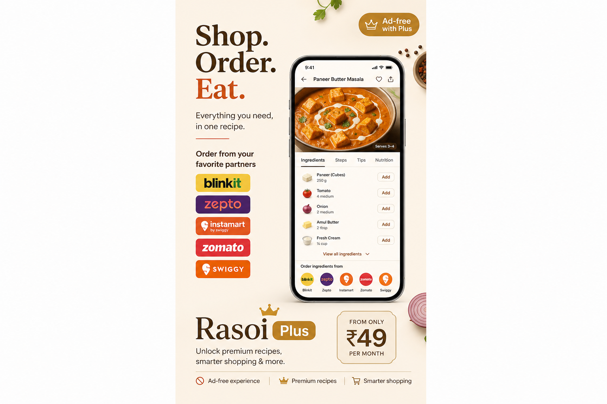

# Rasoi — Indian Recipe App

**Aaj kya banaye? Dinner from your pantry and your region.**

Rasoi is an Indian home-cooking app: regional recipes, pantry match, saved favourites, and one-tap grocery / food delivery for missing ingredients. Built for real Indian kitchens — Veg, Jain, Egg, and Non-Veg.

[](https://rasoiapplication.in)
[](https://rasoiapplication.in/download)
[](https://play.google.com/store/apps/details?id=com.bhagihiri.rasoiapp)


   

## Live

| | |
|---|---|
| Website | [rasoiapplication.in](https://rasoiapplication.in) |
| Download page | [rasoiapplication.in/download](https://rasoiapplication.in/download) |
| Play Store landing | [rasoiapplication.in/play-store](https://rasoiapplication.in/play-store) |
| Google Play | [Store listing — com.bhagihiri.rasoiapp](https://play.google.com/store/apps/details?id=com.bhagihiri.rasoiapp) |
| Recipe guides | [rasoiapplication.in/indian-recipe-app](https://rasoiapplication.in/indian-recipe-app) |
| US / Canada / Australia | [indian-recipe-app-usa](https://rasoiapplication.in/indian-recipe-app-usa) · [indian-recipe-app-canada](https://rasoiapplication.in/indian-recipe-app-canada) · [indian-recipe-app-australia](https://rasoiapplication.in/indian-recipe-app-australia) |

Android package: `com.bhagihiri.rasoiapp`. iOS App Store listing is not published yet.

| | |
|---|---|
| **App** | Expo / React Native |
| **Backend** | Next.js on Vercel |
| **Database** | Supabase (PostgreSQL, Auth, Realtime) |

## Download Android APK

Install the latest release on your phone (enable **Install unknown apps** for your browser or file manager):

**[Download rasoi-release.apk](https://github.com/Bhagirihi/Rasoi/releases/latest/download/rasoi-release.apk)**

| | |
|---|---|
| Package | `com.bhagihiri.rasoiapp` |
| Version | 1.0.0 (versionCode 1) |

> Release builds are currently signed with a debug keystore for sideloading and testing. Use a production keystore before Play Store submission.

## What's in the app

- **Home** — personalized greeting, tonight's picks, hero recipe
- **Recipe** — search, quick filters, pantry mode, 4,000+ dishes
- **Pantry** — mark what you have; match recipes you can cook now
- **Saved** — bookmark favourites and shop missing items
- **Settings** — diet, region, theme, Rasoi Plus trial

Backend features: auth, recipes, sponsors, affiliate partners, meal notifications, admin dashboard.

## Repository layout

```
Rasoi/
├── App (rasoi_mobile/)       # Expo app (Android / iOS)
├── Backend (rasoi_backend/)  # Next.js API + /admin
└── README.md                 # this file
```

## Quick start — App

```bash
cd rasoi_mobile
npm install
cp .env.example .env   # set EXPO_PUBLIC_API_URL, Supabase keys
npm start              # Expo dev server
npm run android        # run on device/emulator
```

### Build release APK locally

Requires JDK 17+ and Android SDK:

```bash
cd rasoi_mobile
export JAVA_HOME="$(/usr/libexec/java_home -v 17 2>/dev/null || echo /usr/local/opt/openjdk@17/libexec/openjdk.jdk/Contents/Home)"
npm run android:release-apk
# Output: dist/rasoi-release.apk
```

## Quick start — Backend

See [`Backend README`](rasoi_backend/README.md) for Supabase setup, seeding, Vercel deploy, and API docs.

```bash
cd rasoi_backend
npm install
cp .env.example .env
npm run db:sync
npm run dev
```

Admin: [http://localhost:3000/admin](http://localhost:3000/admin) (default seed credentials in Backend README).

## Environment (App)

| Variable | Purpose |
|----------|---------|
| `EXPO_PUBLIC_API_URL` | Rasoi backend base URL (e.g. `https://your-app.vercel.app/api`) |
| `EXPO_PUBLIC_SUPABASE_URL` | Supabase project URL |
| `EXPO_PUBLIC_SUPABASE_PUBLISHABLE_KEY` | Supabase anon/publishable key |
| `EXPO_PUBLIC_SENTRY_DSN` | Sentry DSN for crash reporting (production builds) |

## Device QA

```bash
cd rasoi_mobile
npm run qa:preflight   # adb + Maestro checks
npm run qa:smoke       # smoke flows on connected device
```

Maestro flows live in `rasoi_mobile/e2e/maestro/`.

## Notifications

Users with notifications enabled receive:

| Type | When | Source |
|------|------|--------|
| Meal picks (×5) | 6:00, 10:30, 14:00, 17:30, 20:00 IST (2 hr before meal; user timezone) | Supabase pg_cron → backend → Expo Push |
| Daily nudges | 5:00 PM & 10:00 PM | Local on device |

Configure GitHub secrets `CRON_SECRET` and `MEAL_NOTIFICATIONS_URL` for manual backup — see [`Backend README`](rasoi_backend/README.md#meal-push-notifications-5-daily). Primary scheduler: **Supabase pg_cron**.

## Error monitoring (Sentry)

Rasoi reports app crashes to [Sentry](https://sentry.io) when `EXPO_PUBLIC_SENTRY_DSN` is set.

| App | Env var | Sentry project |
|-----|---------|----------------|
| App | `EXPO_PUBLIC_SENTRY_DSN` | `rasoi-mobile` |

App captures: unhandled errors, API failures, user context, session replays on error, console warn/error logs, screenshots, and view hierarchy.

See `rasoi_mobile/.env.example`. Set `SENTRY_AUTH_TOKEN` in EAS/CI for source map uploads.

## Marketing

30 ready-to-post captions for LinkedIn, Instagram, and X: [`docs/marketing/social-posts-30.md`](docs/marketing/social-posts-30.md)

## Releases

APKs are published on [GitHub Releases](https://github.com/Bhagirihi/Rasoi/releases). To publish a new build:

```bash
cd rasoi_mobile && npm run android:release-apk
gh release create v1.0.0 dist/rasoi-release.apk --title "Rasoi 1.0.0" --notes "Release notes…"
```

## License

Private project — all rights reserved.
