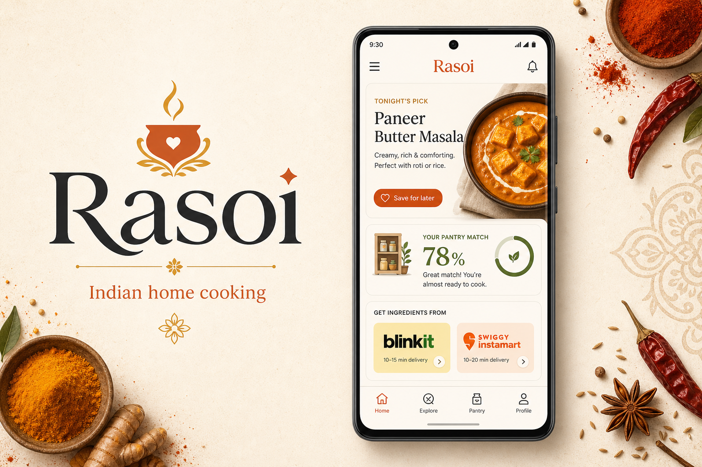
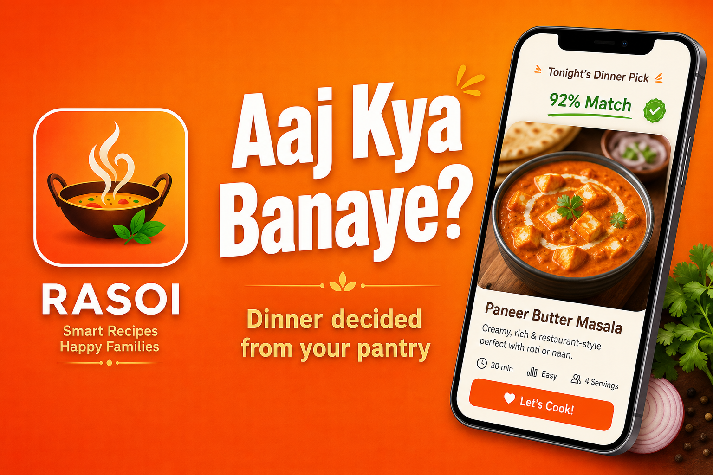
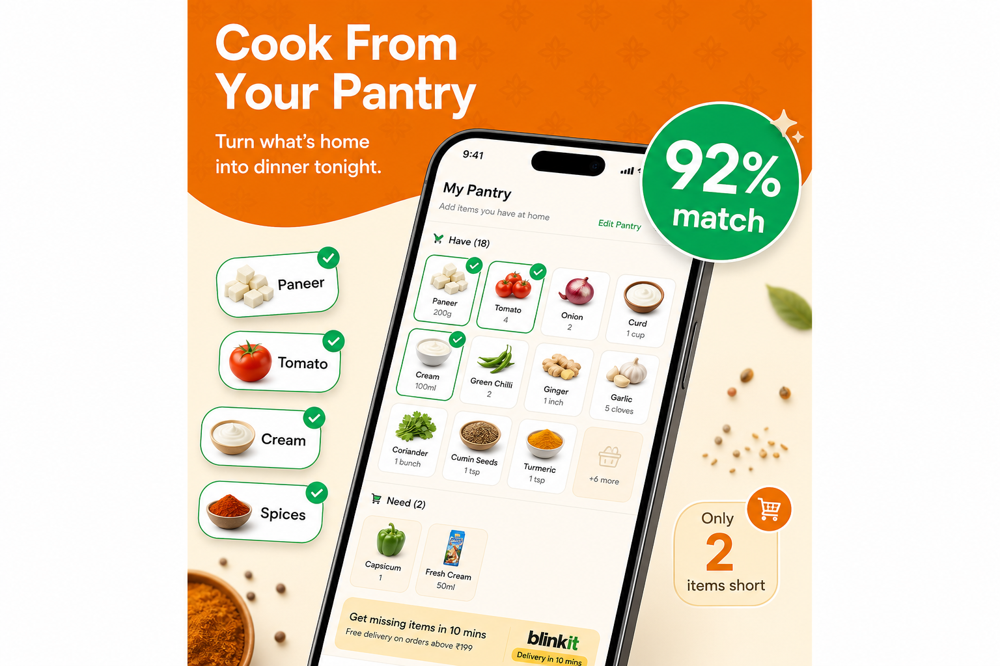

# Rasoi — Indian Recipe App

**Aaj kya banaye?** Dinner from your pantry and your region.

Rasoi is an Indian home-cooking app: regional recipes, pantry match, saved favourites, and one-tap grocery / food delivery for missing ingredients. Built for real Indian kitchens — Veg, Jain, Egg, and Non-Veg.

[](https://rasoiapplication.in)
[](https://play.google.com/store/apps/details?id=com.bhagihiri.rasoiapp)

<p align="center">
  
</p>

<p align="center">
  
</p>

<p align="center">
  
  
  
  
</p>

---

## Live

| | |
|---|---|
| **Website** | [rasoiapplication.in](https://rasoiapplication.in) |
| **Download page** | [rasoiapplication.in/download](https://rasoiapplication.in/download) |
| **Play Store landing** | [rasoiapplication.in/play-store](https://rasoiapplication.in/play-store) |
| **Google Play** | [Store listing — `com.bhagihiri.rasoiapp`](https://play.google.com/store/apps/details?id=com.bhagihiri.rasoiapp) |
| **Recipe guides** | [rasoiapplication.in/indian-recipe-app](https://rasoiapplication.in/indian-recipe-app) |
| **US / Canada / Australia** | [/indian-recipe-app-usa](https://rasoiapplication.in/indian-recipe-app-usa) · [/indian-recipe-app-canada](https://rasoiapplication.in/indian-recipe-app-canada) · [/indian-recipe-app-australia](https://rasoiapplication.in/indian-recipe-app-australia) |

Android package: `com.bhagihiri.rasoiapp`. iOS App Store listing is not published yet.

---

## Product

- **5,000+ recipes** across North, South, East, West, and Central India
- **Pantry match** — cook from dal, rice, paneer, masalas you already have
- **Filters** — under 20 minutes, kid-friendly, leftover-friendly, festive
- **Rasoi Plus** — Blinkit, Zepto, Instamart, Zomato, and Swiggy checkout for missing items
- **Meal reminders** and saved collections
- **15-day Plus trial**, then **₹49 / month** or **₹499 / year**
- **Sponsorship** placements for brands on Home, Recipes, Pantry, Saved, and recipe detail

Developer listing name: **Karbh It Solutions**.

---

## Repository

```
Rasoi/
├── App/        # Expo / React Native app (Expo Router)
└── backend/    # Next.js marketing site, APIs, recipe DB scripts
```

**App stack:** Expo 54 · Expo Router · React Native Firebase · Supabase · RevenueCat · AdMob · Sentry

**Website / API stack:** Next.js · Prisma · Supabase Postgres · Firebase (push / optional catalog storage)

---

## Run locally

### Mobile app

```bash
cd App
cp .env.example .env
npm install
npx expo start
```

Set RevenueCat (and optional Razorpay) keys in `.env`. See `App/docs/PRODUCTION_CHECKLIST.md` before a store build.

### Website

```bash
cd backend
cp .env.example .env.local
npm install
npm run dev
```

Open [http://localhost:3000](http://localhost:3000). Canonical production URL is `https://rasoiapplication.in`.

Smoke-check production recipes:

```bash
curl -s -o /dev/null -w "%{http_code}\n" https://rasoiapplication.in/api/recipes
```

---

## License

Private product source for [Bhagirihi](https://github.com/Bhagirihi). Website and Play listing: [rasoiapplication.in](https://rasoiapplication.in).
