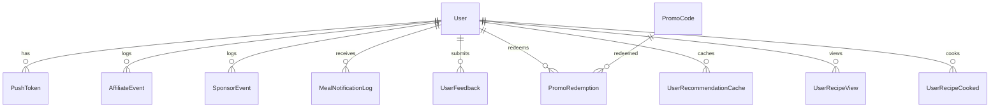

# Database Documentation

**Source of truth:** `rasoi_mobile/supabase/migrations/*.sql`  
**Reference schema:** `rasoi_backend/prisma/schema.prisma` (documentation only; no Prisma client at runtime)  
**Schema name:** `rasoi` (PascalCase quoted identifiers)

---

## Overview

- **23 tables** in `rasoi` schema
- **Auth bridge:** `rasoi."User"."supabaseUserId"` ↔ `auth.users.id` (no FK)
- **RLS** enabled on catalog + user-owned tables for mobile `authenticated` role
- **Service role** used by Next.js backend for admin and privileged operations
- **Storage buckets:** Not implemented in Supabase migrations
- **Legacy `public` schema:** Partially dropped; app uses `rasoi` exclusively

---

## Tables

### `rasoi."User"`

| Column | Type | Constraints |
|--------|------|-------------|
| id | TEXT | PK |
| supabaseUserId | TEXT | UNIQUE (partial index) |
| email | TEXT | UNIQUE |
| phone | TEXT | UNIQUE |
| name | TEXT | |
| isGuest | BOOLEAN | default false |
| role | UserRole enum | USER, ADMIN |
| isActive | BOOLEAN | default true |
| hasCompletedOnboarding | BOOLEAN | |
| dietPreference | TEXT | Veg/Egg/Non-Veg |
| dietChoice | TEXT | Veg/Egg/Non-Veg/Jain |
| regionalCuisine | TEXT | |
| favoriteCuisines | TEXT | JSON array |
| notificationsEnabled | BOOLEAN | |
| timezone | TEXT | default Asia/Kolkata |
| city, state | TEXT | |
| latitude, longitude | DOUBLE PRECISION | |
| locationUpdatedAt | TIMESTAMP | |
| pantryIngredients | TEXT | JSON array, max 200 items |
| savedRecipeIds | TEXT | JSON array, max 500 |
| kitchenPreferences | TEXT | JSON object |
| planTier | TEXT | free, trial, paid |
| trialStartedAt | TIMESTAMP | |
| hasUsedTrial | BOOLEAN | |
| trialBonusDays | INTEGER | default 0 |
| yearlyPromoOfferTag | TEXT | |
| termsAcceptedAt | TIMESTAMP | |
| termsAcceptedVersion | TEXT | |
| createdAt, updatedAt | TIMESTAMP | |

**Inbound FKs from:** PushToken, AffiliateEvent, SponsorEvent, MealNotificationLog, UserFeedback, PromoRedemption, UserRecommendationCache, UserRecommendationHistory, UserRecipeView, UserRecipeCooked

---

### `rasoi."Recipe"`

| Column | Type | Notes |
|--------|------|-------|
| id | TEXT | PK |
| title | TEXT | |
| prepTime | INTEGER | minutes |
| calories | INTEGER | |
| region | TEXT | North/South/East/West/Central |
| kitchenStyleId | TEXT | default north (API synthesizes kitchenStyleIds as `[kitchenStyleId]`) |
| dietType | TEXT | Veg/Egg/Non-Veg |
| difficulty | TEXT | Easy/Medium/Hard |
| imageUrl | TEXT | external URL |
| ingredients | TEXT | JSON array |
| main_ingredients | TEXT | nullable summary from scrape |
| steps | TEXT | JSON array, nullable |
| descriptionHi | TEXT | nullable Hindi blurb (EN description synthesized on read) |
| stepsHi | TEXT | nullable JSON array of Hindi steps |
| primaryIngredient | TEXT | |
| popularityScore | INTEGER | default 50 |
| qualityScore | INTEGER | default 50 |
| published | BOOLEAN | default true |
| createdAt, updatedAt | TIMESTAMP | |

Dropped (do not write): `kitchenStyleIds`, `description`, `tags`, scrape twins (`cuisine`, `diet`, `method`, `image_url`, `sourceUrl`, `sourceSite`, `scrapedAt`).

---

### Other `rasoi` Tables (summary)

| Table | PK | Purpose |
|-------|-----|---------|
| Admin | id | Admin console users (bcrypt password) |
| KitchenStyle | id | Regional cuisine catalog |
| RegionalCuisineOption | label | Cuisine picker options |
| PantrySection | id | Pantry UI sections + default items |
| PartnerLink | partnerId | Affiliate deep links by region |
| Sponsor | id | In-app sponsor cards |
| AppSettings | id (default) | paymentsEnabled, paymentsMinAppVersion, defaultPantryIngredients |
| PushToken | id | Expo push tokens per user |
| AffiliateEvent | id | Partner click telemetry |
| SponsorEvent | id | Sponsor impression/tap telemetry |
| MealNotificationLog | id | Cron dedup for push sends |
| ProcessedWebhookEvent | eventId | RevenueCat webhook idempotency |
| PromoCode | id | Trial extend / yearly discount codes |
| PromoRedemption | id | User promo redemption tracking |
| UserRecommendationCache | id | Per-user meal window cache |
| UserRecommendationHistory | id | Shown pick history |
| UserRecipeView | id | View logging for recommendations |
| UserRecipeCooked | id | Cook event logging |
| HomeAnnouncement | id | Admin home modal/banner campaigns |
| SponsorApplication | id | Public sponsor intake form |
| UserFeedback | id | In-app feedback tickets |

---

## Relationships

**Logical (no FK):** Recipe IDs referenced in JSON columns and event tables.

---

## RLS Policies

Migration: `20250621140000_rasoi_public_read_rls.sql`, `20250621150000_rasoi_user_write_rls.sql`

| Policy | Table | Command | Condition |
|--------|-------|---------|-----------|
| mobile_read_published_recipes | Recipe | SELECT | published = true |
| mobile_read_active_* | KitchenStyle, RegionalCuisineOption, PantrySection, PartnerLink, Sponsor | SELECT | active = true |
| mobile_read_app_settings | AppSettings | SELECT | true |
| mobile_read_own_user | User | SELECT | supabaseUserId = auth.uid() |
| mobile_update_own_user | User | UPDATE | own row |
| mobile_manage_own_push_tokens | PushToken | ALL | own userId |
| mobile_insert_own_affiliate_events | AffiliateEvent | INSERT | own or null userId |
| mobile_insert_own_sponsor_events | SponsorEvent | INSERT | own or null userId |
| mobile_insert_feedback | UserFeedback | INSERT | own or null userId |

**RLS enabled, no mobile policies (service role only):** Admin, MealNotificationLog, SponsorApplication

**No RLS in migrations (backend only):** PromoCode, PromoRedemption, ProcessedWebhookEvent, recommendation tables, HomeAnnouncement

---

## Triggers & Functions

| Object | Migration | Purpose |
|--------|-----------|---------|
| `protect_user_sensitive_columns()` | 20250621150000 | Block JWT updates to plan/auth columns |
| `rasoi.start_trial()` | 20250621180000, 20250625103000 | SECURITY DEFINER trial start |
| `rasoi_cron.invoke_meal_notifications()` | 20250626120000 | pg_net HTTP to cron API |

**Protected columns on User UPDATE:** planTier, trialStartedAt, hasUsedTrial, trialBonusDays, yearlyPromoOfferTag, role, isActive, isGuest, email, supabaseUserId, termsAcceptedAt, termsAcceptedVersion, createdAt

---

## Indexes (selected)

| Index | Table |
|-------|-------|
| User_supabaseUserId_key (partial UNIQUE) | User |
| Recipe_kitchenStyleId_idx | Recipe |
| PartnerLink_region_idx | PartnerLink |
| user_recommendation_cache_unique | UserRecommendationCache |
| user_recipe_view_unique | UserRecipeView |
| user_recipe_cooked_unique | UserRecipeCooked |
| home_announcement_active_idx | HomeAnnouncement |
| PromoRedemption_userId_redeemedAt_idx | PromoRedemption |

---

## Cron Jobs (Supabase pg_cron)

| Job | Schedule (UTC) | Slot |
|-----|----------------|------|
| rasoi-push-breakfast | 30 0 * * * | Breakfast |
| rasoi-push-lunch | 0 5 * * * | Lunch |
| rasoi-push-snack | 30 8 * * * | Snack |
| rasoi-push-dinner | 0 12 * * * | Dinner |
| rasoi-push-late-night | 30 14 * * * | Late night |

Invokes: `GET /api/cron/meal-notifications` with `CRON_SECRET`

---

## Authentication Flow (database perspective)

1. User authenticates via Supabase Auth (OTP or anonymous)
2. Backend `POST /api/auth/supabase-sync` or `/api/auth/guest` creates/updates `rasoi.User`
3. `supabaseUserId` links auth identity to app profile
4. Mobile direct reads use RLS with `auth.uid()`
5. Plan changes via service role, RevenueCat webhook, or `start_trial()` RPC

---

## Realtime

`rasoi_backend/prisma/supabase-realtime.sql` adds `rasoi` tables to `supabase_realtime` publication for live admin/mobile updates.

---

## Legacy `public` Schema

Initial migration `20250610120000_rasoi_schema.sql` created `profiles`, `user_subscriptions`, etc.

Migration `20250625200000_drop_legacy_public_recipe_mirror.sql` dropped recipe/pantry mirror tables.

**Active app data:** `rasoi` schema only.

---

## Storage Buckets

**Not implemented** in Supabase migrations. Images use external URLs (Unsplash, etc.). Firebase Storage referenced in mobile Firebase config only.

---

## Migration File Index

See `rasoi_mobile/supabase/migrations/` — 22 files from `20250610120000` through `20250627140000`.

Apply to remote Supabase before shipping code that depends on new schema (per workspace rules).
