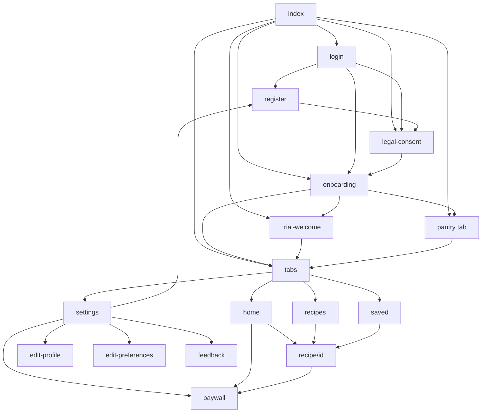

# Navigation Map

Mobile navigation uses **Expo Router**. Types: **Stack**, **Tab**, **Card** (stack presentation). No Drawer navigator.

---

## Navigation Hierarchy

```
Root Stack (_layout.tsx)
├── index                    [Stack] Bootstrap redirect
├── (auth) Stack             [Stack, gestureEnabled: false]
│   ├── login
│   ├── register
│   ├── legal-consent
│   ├── onboarding
│   └── trial-welcome
├── (tabs) Tab Navigator     [Tab]
│   ├── index (Home)
│   ├── recipes
│   ├── pantry
│   ├── saved
│   └── settings Stack       [Stack nested in tab]
│       ├── index
│       ├── edit-profile
│       ├── edit-preferences
│       └── feedback
├── recipe/[id]              [Stack Card, slide_from_right]
└── paywall                  [Stack Card, slide_from_right]
```

---

## Screen Navigation Matrix

| Screen | Path | Nav Type | Auth Required | Can Navigate To | Opened From |
|--------|------|----------|---------------|-----------------|-------------|
| Bootstrap | `/` (`index.tsx`) | Stack redirect | No | login, auth/*, tabs/* | App launch |
| Login | `/(auth)/login` | Stack | No | register, guest flow destinations | index, logout, tab guard |
| Register | `/(auth)/register` | Stack | No | legal-consent, login | login, settings upgrade |
| Legal Consent | `/(auth)/legal-consent` | Stack | Partial | onboarding | register OTP, guest login, index |
| Onboarding | `/(auth)/onboarding` | Stack | Yes | pantry, trial-welcome, tabs | legal-consent, login, register, index |
| Trial Welcome | `/(auth)/trial-welcome` | Stack | Yes | tabs, paywall | index, tab guard, post-auth |
| Home | `/(tabs)/` | Tab | Yes | recipe/[id], paywall, modals | tabs default |
| Recipes | `/(tabs)/recipes` | Tab | Yes | recipe/[id], paywall | tab bar, notification |
| Pantry | `/(tabs)/pantry` | Tab | Yes | paywall, partner modals | tab bar, pendingPantrySetup |
| Saved | `/(tabs)/saved` | Tab | Yes | recipe/[id] | tab bar |
| Settings | `/(tabs)/settings` | Tab→Stack | Yes | edit-profile, edit-preferences, feedback, register, paywall | tab bar |
| Edit Profile | `/(tabs)/settings/edit-profile` | Stack | Yes | register (guest) | settings |
| Edit Preferences | `/(tabs)/settings/edit-preferences` | Stack | Yes | — | settings |
| Feedback | `/(tabs)/settings/feedback` | Stack | Yes | — | settings |
| Recipe Detail | `/recipe/[id]` | Stack Card | Yes* | paywall, partner links | home, recipes, saved, notification |
| Paywall | `/paywall` | Stack Card | Yes | — (back) | settings, modals, upsells |
| Not Found | `+not-found` | Stack | No | `/` | invalid deep link |

\*Recipe detail requires logged-in state for full features; catalog may load without auth for some data paths.

---

## Tab Guard Conditions (`(tabs)/_layout.tsx`)

Redirects away from tabs if:

| Condition | Redirect Target |
|-----------|-----------------|
| `!isHydrated` | `/` |
| `!hasCompletedOnboarding` | `/(auth)/onboarding` |
| `!isLoggedIn` | `/(auth)/login` |
| `pendingTrialWelcome && !pendingPantrySetup` | `/(auth)/trial-welcome` |
| `pendingPantrySetup && not on pantry` | `/(tabs)/pantry` |

---

## Auth Gate Summary

| Screen | Guest OK | Registered | Onboarding Required |
|--------|----------|------------|---------------------|
| Login, Register | Yes | N/A | No |
| Legal Consent | Yes | Yes | No |
| Onboarding | Yes | Yes | Self |
| Tabs | Yes | Yes | Yes |
| Paywall | Yes | Yes | Yes |
| Recipe Detail | Yes | Yes | Yes |

---

## Modal / Overlay Navigation (non-route)

These are React modals, not Expo Router screens:

| Component | Triggered From | Action |
|-----------|----------------|--------|
| `GuestContinueModal` | Login | Guest login |
| `TrialExpiredPaywallModal` | Global bridge | → paywall |
| `TrialEndingSoonModal` | Global bridge | → paywall |
| `AffiliateCheckoutModal` | Recipe, pantry, saved | External partner URL |
| `FoodDeliveryModal` | Recipe detail | Zomato/Swiggy |
| `HomeAnnouncementModal` | Home | CTA link |
| `CookTonightSheet` | Recipes tab | Recipe selection |
| `DeleteAccountReasonModal` | Settings | Account deletion |
| `AppDialogHost` | Global | Alerts |

---

## Notification → Screen Mapping

(`utils/notifications.ts` → `useNotificationNavigation`)

| Payload `type` | Destination |
|----------------|-------------|
| `daily_reminder` | `/(tabs)/` |
| `admin_message` | `/(tabs)/recipes` |
| `meal_pick` | `/recipe/{recipeId}` |

---

## Deep Link Routes

| Scheme | Handler |
|--------|---------|
| `rasoi://` | Expo Router default |
| Universal / App Links | **Not implemented** |

---

## Backend Web Navigation (marketing)

Not part of mobile app; documented for completeness:

| Path | Type |
|------|------|
| `/` | Market landing |
| `/download` | APK/Play download page |
| `/play-store` | Play Store SEO |
| `/privacy`, `/terms` | Legal |
| `/admin/*` | Admin console (cookie auth) |
| `/[seo-slug]` | Static SEO articles |

---

## Navigation Dependency Graph



---

## Query Parameters

| Screen | Params | Effect |
|--------|--------|--------|
| `legal-consent` | `from=register\|guest` | Context for consent flow |
| `onboarding` | `permissionsOnly=1` | Skip food prefs, only permissions |
| `onboarding` | `step=notifications\|location` | Initial permission step |
