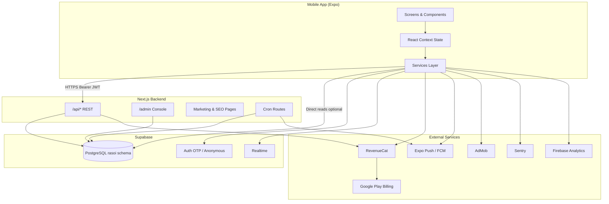
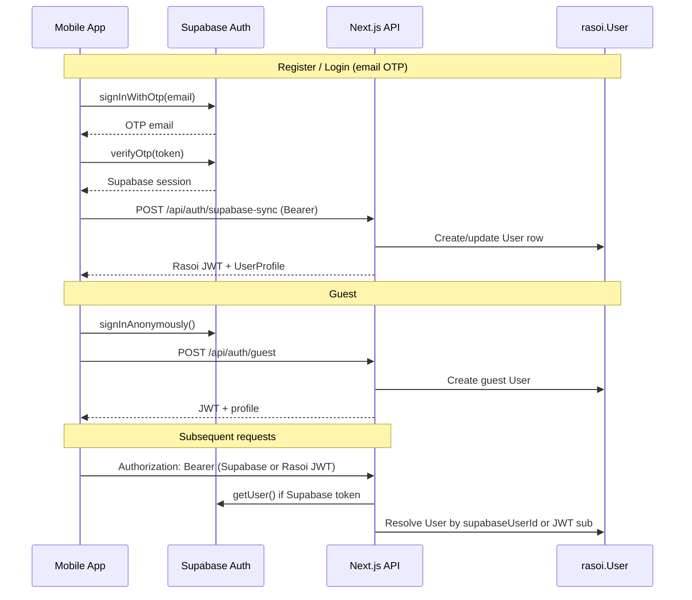

# System Architecture

## Overview

Rasoi is a three-tier system: **Expo mobile client**, **Next.js API/admin on Vercel**, and **Supabase** (PostgreSQL, Auth, Realtime). The mobile app is the primary user surface; the backend serves REST APIs, marketing SEO pages, cron jobs, and an admin console.

---

## Component Responsibilities

### Mobile (`rasoi_mobile/`)

| Layer | Role |
|-------|------|
| `app/` | Expo Router file-based screens and navigation |
| `context/` | Global state (auth, recipes, partners, theme, dialogs) |
| `services/` | API + optional direct Supabase calls |
| `utils/` | Auth tokens, storage, plan logic, notifications, telemetry |
| `components/` | UI, bridges (RevenueCat, analytics, notifications) |
| `hooks/` | Screen-specific data and interaction logic |
| `constants/` | Plans, payments, theme, test IDs |

**State management:** React Context only (no Redux/Zustand). `AppContext` is the central auth/user/plan/pantry brain.

**Networking:** `utils/api.ts` — `apiFetch`, `authApiFetch`, `optionalAuthApiFetch` to `EXPO_PUBLIC_API_URL` (default `https://rasoiapplication.in`).

**Optional direct Supabase reads:** When `EXPO_PUBLIC_DIRECT_SUPABASE_READS=1`, catalog and user rows can bypass API for latency; controlled by env flags.

### Backend (`rasoi_backend/`)

| Layer | Role |
|-------|------|
| `src/app/api/` | REST API with `{ ok, data }` / `{ ok, error }` envelope |
| `src/app/admin/` | Server-rendered admin console with cookie auth |
| `src/lib/` | DB repository, auth, billing, recommendations, validators |
| `src/middleware.ts` | CORS for API, geo market redirect, Supabase session refresh |
| `prisma/schema.prisma` | Schema reference only (no Prisma client at runtime) |

**Database access:** `@/lib/db` — Supabase service role PostgREST + optional `pg` for raw SQL.

### Database (Supabase)

- Primary schema: **`rasoi`** (PascalCase quoted tables)
- Auth bridge: `rasoi.User.supabaseUserId` ↔ `auth.users.id`
- RLS on catalog + user-owned rows for mobile `authenticated` role
- Sensitive plan columns protected by `protect_user_sensitive_columns` trigger
- Legacy `public` schema tables partially dropped; app uses `rasoi` exclusively

---

## Authentication Architecture

**Token storage:** AsyncStorage (`@rasoi/auth_token`, Supabase session). **SecureStore is not used.**

**Admin auth:** Separate — bcrypt password → HS256 JWT in HttpOnly cookie `rasoi_admin_token`.

---

## Data Flow — Recipe Discovery

1. `ReferenceContext` loads `/api/reference` (cuisines, pantry sections, kitchen styles, `paymentsEnabled`)
2. `RecipesContext` paginates `/api/recipes` or direct `Recipe` table
3. `TonightRecipesContext` fetches `/api/recommendations` for meal picks
4. Pantry match computed client-side from `User.pantryIngredients` JSON
5. Recipe detail: `/api/recipes/:id` + view/cook logging endpoints

**Offline:** Cached catalog (`recipeCatalogCache`), bundled starter recipes (`data/offlineStarterRecipes.ts`), offline recommendation snapshots. No offline write queue.

---

## Monetization Architecture

| Tier | Ads | Partners | Source |
|------|-----|----------|--------|
| Free | Yes | Limited (2 shops/month after trial) | `constants/plans.ts` |
| Trial (3 days + bonus) | Yes | Full (trial mode) | `planLogic.ts` |
| Paid (Rasoi Plus) | No | Full | RevenueCat → Play Billing |

Flow: `RevenueCatBridge` configures SDK → user purchases on paywall → `POST /api/billing/confirm` → webhook `POST /api/billing/revenuecat/webhook` syncs `planTier`.

Server gate: `AppSettings.paymentsEnabled` must be true for trial RPC and purchases.

---

## Push Notifications

| Type | Mechanism |
|------|-----------|
| Local scheduled | 5 daily meal reminders (`expo-notifications`) |
| Remote (cron) | Supabase pg_cron → `GET /api/cron/meal-notifications` → Expo Push API |
| Trial nudge | Local day-2 reminder |
| Saved recipe | Local thank-you notification |

Token registration: `PUT /api/users/me/push-token`

---

## Analytics & Telemetry

| System | Integration |
|--------|-------------|
| Sentry | `utils/sentry.ts`, error boundaries |
| Firebase Analytics | Optional via `@react-native-firebase/analytics` |
| Firebase Crashlytics | Optional native |
| Affiliate/Sponsor events | `POST /api/affiliate-events`, `/api/sponsor-events` |
| Recipe search analytics | `POST /api/recipe-searches` |

---

## Deployment Topology

| Component | Host | Trigger |
|-----------|------|---------|
| Backend + admin | Vercel (`rasoiapplication.in`) | GitHub push |
| Database | Supabase cloud | Migrations via SQL editor / `supabase db push` |
| Mobile APK | `rasoi_backend/public/rasoi-release.apk` | Local build + `npm run sync:apk` |
| Play Store | Google Play Console | Manual AAB upload |
| OTA updates | EAS Update | `npm run ota:production` |

**Branches:** `main` = production (frozen); `development` = active work (per `.cursor/rules/code-freeze-change-review.mdc`).

---

## Deep Linking

- **Inbound:** `rasoi://` custom scheme only (Android intent filters in `AndroidManifest.xml`)
- **Outbound:** Partner apps (zomato, swiggy, blinkit, zepto) via `LSApplicationQueriesSchemes` / `openPartnerUrl`
- **Notification navigation:** `useNotificationNavigation` maps payload types to routes

**Universal links / App Links:** Not implemented in `app.json`.

---

## Error Handling

| Layer | Pattern |
|-------|---------|
| API | Zod validation → 400; `handleApiError` → 500; business `jsonError` with status |
| Mobile | `AppErrorBoundary`, `AppCrashFallback`, Sentry GlobalErrorBoundary |
| Network | User-facing messages in `utils/api.ts`; non-critical paths skip Sentry |

---

## Feature Flags

**Not implemented** as a remote flag service. Build-time / server toggles:

- `EXPO_PUBLIC_DIRECT_SUPABASE_READS`
- `EXPO_PUBLIC_DIRECT_SUPABASE_CATALOG`
- `EXPO_PUBLIC_PAYMENT_PROVIDER` (`revenuecat` | `stub` | `razorpay`)
- `EXPO_PUBLIC_SCREENSHOT_MODE`
- Server `AppSettings.paymentsEnabled`
