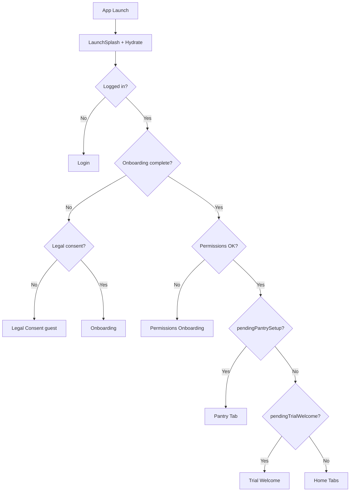
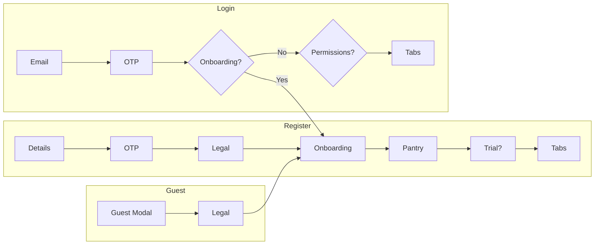
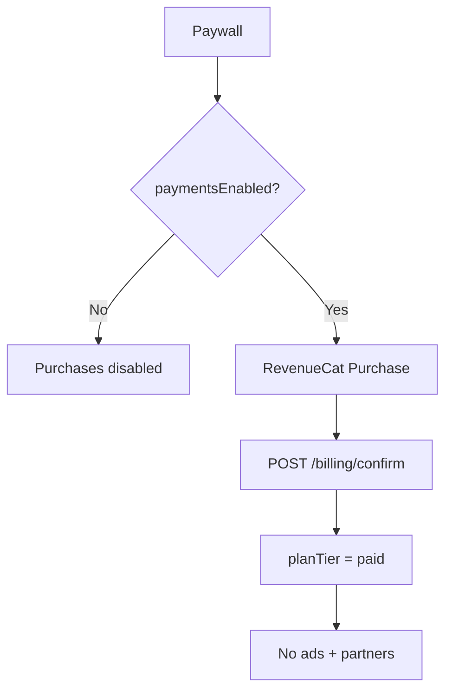
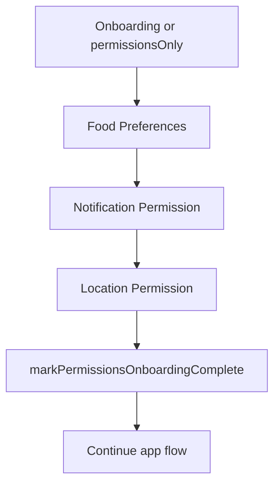

# User Flows

All flows derived from `rasoi_mobile/app/`, `utils/authNavigation.ts`, `context/AppContext.tsx`, and `.cursor/rules/mobile-auth-navigation-flow.mdc`.

---

## 1. First Launch / Cold Start

**Purpose:** Initialize app, restore session, route to correct entry screen.

**Preconditions:** Fresh install or returning user.

**Steps:**

1. `LaunchSplash` displays while fonts load (`_layout.tsx`)
2. `LaunchSplashGate` waits for `AppContext` hydration
3. `app/index.tsx` evaluates: legal consent, permissions, auth, onboarding flags
4. Route outcome (see decision tree below)

**Screens:** Launch Splash → Index (bootstrap) → destination

**Decision points:**

| Condition | Destination |
|-----------|-------------|
| Not logged in | `/(auth)/login` |
| Logged in, onboarding incomplete, no legal consent | `/(auth)/legal-consent?from=guest` |
| Logged in, onboarding incomplete, legal done | `/(auth)/onboarding` |
| Onboarding done, permissions missing | `/(auth)/onboarding?permissionsOnly=1` |
| `pendingPantrySetup` | `/(tabs)/pantry` |
| `pendingTrialWelcome` | `/(auth)/trial-welcome` |
| Else | `/(tabs)` (Home) |

**Errors:** Bootstrap overlay shows during async checks; no explicit error screen.

**Final outcome:** User lands on Login or main app.

---

## 2. Splash Screen

**Purpose:** Brand display during font load and initial hydration.

**Implementation:** `components/LaunchSplash.tsx` + `LaunchSplashGate.tsx`

**Note:** Splash has no Login/Register buttons; routing happens in `index.tsx` after dismiss.

---

## 3. Registration (New Account)

**Purpose:** Create registered user with email OTP.

**Preconditions:** User on Login screen.

**Steps:**

1. Navigate to Register from Login
2. Enter name, phone (Indian 10-digit), email
3. Submit → OTP sent via Supabase `signInWithOtp`
4. Enter OTP → `verifyEmailOtpAndLogin`
5. Redirect to `/(auth)/legal-consent?from=register`
6. Accept Terms & Privacy → `saveLegalConsent`
7. Onboarding: food prefs → notifications permission → location permission
8. Pantry setup (`pendingPantrySetup`) → Pantry tab
9. Optional Trial Welcome screen
10. Dashboard (tabs)

**Screens:** Register → Legal Consent → Onboarding → Pantry → Trial Welcome → Tabs

**Errors:** Invalid email/phone, disposable email blocked, OTP invalid, network failure

**Alternative paths:** Guest upgrade from Settings uses Register (not Login)

---

## 4. Login (Existing Account)

**Purpose:** Authenticate returning user via email OTP.

**Preconditions:** Valid existing account.

**Steps:**

1. Enter email → `sendLoginEmailOtp`
2. Enter OTP → `verifyLoginEmailOtp`
3. `resolvePostAuthHref`:
   - If onboarding incomplete → full Onboarding
   - Else if OS permissions missing → `onboarding?permissionsOnly=1`
   - Else if `pendingPantrySetup` → Pantry
   - Else if trial welcome pending → Trial Welcome
   - Else → Tabs

**Note:** Login does **not** show legal-consent (register-only).

**Forgot password:** **Not implemented** — no password-based auth.

---

## 5. OTP Verification

**Purpose:** Verify email ownership via Supabase OTP.

**Implementation:** `services/supabaseAuth.ts` — `sendEmailOtp`, `verifyEmailOtp`

**Validation:** Email format, disposable email rejection (`utils/identityValidation.ts`)

**Errors:** Invalid OTP, expired OTP, email delivery unavailable

**Pending verification:** `EmailVerificationBridge` handles interrupted flows

---

## 6. Logout

**Purpose:** End session and clear local state.

**Preconditions:** Logged-in user in Settings.

**Steps:**

1. Settings → Log out
2. `logout()` in AppContext: clear tokens, Supabase signOut, AsyncStorage keys
3. Redirect to Login

**Screens:** Settings → Login

---

## 7. Guest Login (Explore as Guest)

**Purpose:** Anonymous trial of app without registration.

**Steps:**

1. Login → "Explore as Guest" → `GuestContinueModal` (optional name)
2. `loginAsGuest` → Supabase anonymous + `POST /api/auth/guest`
3. `resolveGuestLoginHref`:
   - Legal consent (`from=guest`) if not accepted
   - Onboarding (full, not auto-default prefs)
   - Pantry setup
   - Tabs (no trial welcome for guests per flow)

**Guest restrictions:** Upgrade CTA in Settings routes to Register; limited account features until upgrade.

---

## 8. Dashboard (Home Tab)

**Purpose:** Personalized home with meal picks and discovery.

**Preconditions:** Auth + onboarding complete + tab guards passed.

**Features:** Meal picks, seasonal rail, recent cooks, announcements, partner modals, offline banner.

**Navigation:** Tabs, recipe detail, paywall modals, partner checkout modals.

---

## 9. Pantry Flow

**Purpose:** Manage ingredients user has at home.

**Steps:**

1. Open Pantry tab (or forced on first signup via `pendingPantrySetup`)
2. View sections from reference data
3. Toggle ingredients on/off
4. `PUT /api/users/me/pantry` syncs to server
5. Recipe match % updates across app

**Business logic:** Max 200 ingredients (`pantryUpdateSchema`).

---

## 10. Recipe Flow

**Purpose:** Browse, search, view, cook, save recipes.

**Steps:**

1. Recipes tab or Home → select recipe
2. Recipe detail: ingredients, steps, pantry match, missing items
3. Actions: Save, Share, Mark cooked, Partner shop CTAs
4. `POST /api/recipes/:id/view` and `/cooked` for recommendations

**Premium gates:** Partner checkout limited on free plan (see BUSINESS_RULES.md).

---

## 11. Search Flow

**Purpose:** Find recipes by text query.

**Implementation:** `hooks/useRecipeListSearch.ts`, `GET /api/recipes` with filters, `POST /api/recipe-searches` for analytics.

**Validation:** Search query min 2 chars on server `/api/recipes/search`.

---

## 12. Premium Purchase / Subscription

**Purpose:** Upgrade to Rasoi Plus via Google Play.

**Preconditions:** `paymentsEnabled` true on server.

**Steps:**

1. Open paywall (Settings, trial modals, partner upsell)
2. Select monthly/yearly plan
3. RevenueCat purchase flow
4. `POST /api/billing/confirm` verifies with RevenueCat API
5. Plan updates to `paid`; ads hidden, partners unlocked

**Restore:** `restoreRasoiPlus` via RevenueCat

**Promo codes:** `POST /api/users/me/promo/redeem` — trial extend or yearly discount

---

## 13. Trial Flow

**Purpose:** 3-day Rasoi Plus trial (extendable via promo).

**Steps:**

1. After onboarding signup → Trial Welcome screen
2. `startTrial` → `rasoi.start_trial()` RPC (server)
3. Trial features: partners unlocked, ads still shown
4. Trial ending soon modal → Trial expired paywall modal
5. On expiry: effective tier becomes free

---

## 14. Permissions

### Notification Permission

**When:** Onboarding step 2; permissions-only revisit; Settings toggle enables request.

**Implementation:** `utils/notifications.ts` — `ensureNotificationPermissions`

### Location Permission

**When:** Onboarding step 3; `LocationSyncBridge` background sync.

**Implementation:** `utils/location.ts` — `ensureLocationPermissions`, `requestUserLocation`

**API:** `PUT /api/users/me/location`

### Camera / Storage

**Not implemented** — no camera or photo library permissions in codebase.

---

## 15. Notifications

**Local:** 5 daily meal reminders scheduled client-side.

**Remote:** Server cron sends Expo push with meal pick recipe.

**Tap handling:**

| Type | Navigation |
|------|------------|
| `daily_reminder` | Home tab |
| `admin_message` | Recipes tab |
| `meal_pick` + recipeId | Recipe detail |

---

## 16. Deep Linking

**Inbound:** `rasoi://` scheme — default Expo Router handling.

**Universal links:** Not implemented.

**Outbound:** Partner app deep links (Blinkit, Zepto, Zomato, Swiggy).

---

## 17. Offline Usage

**Behavior:**

- Cached recipes/reference shown when API fails
- 12 bundled starter recipes if catalog empty
- Offline recommendations per meal window
- `OfflineBanner` on Home when recipe load fails
- Pantry/saved writes require network (optimistic UI, no queue)

---

## 18. Session Expired

**Behavior:** Supabase session refresh via `ensureValidSupabaseSession`. On failure, API returns 401; user may need re-login.

**Explicit "session expired" screen:** Not implemented — redirects to login via tab guards.

---

## 19. Error Recovery

| Error | Recovery |
|-------|----------|
| JS crash | `AppCrashFallback` with retry |
| API network | User message; cached data where available |
| Render error | `AppErrorBoundary` |

---

## 20. Settings Sub-flows

| Action | Flow |
|--------|------|
| Edit profile | Settings → edit-profile |
| Edit preferences | Settings → edit-preferences |
| Feedback | Settings → feedback → POST /api/feedback |
| Delete account | Settings → reason modal → DELETE /api/users/me |
| Theme | Toggle in Settings (light/dark) |
| Rate app | `expo-store-review` |

---

## 21. Invite User

**Not implemented** — no invite or shared pantry feature in codebase.

---

## Flow Diagrams Index

See also Mermaid diagrams in [SYSTEM_ARCHITECTURE.md](./SYSTEM_ARCHITECTURE.md) and [NAVIGATION_MAP.md](./NAVIGATION_MAP.md).

### Authentication (combined)

### Premium

### Permissions

